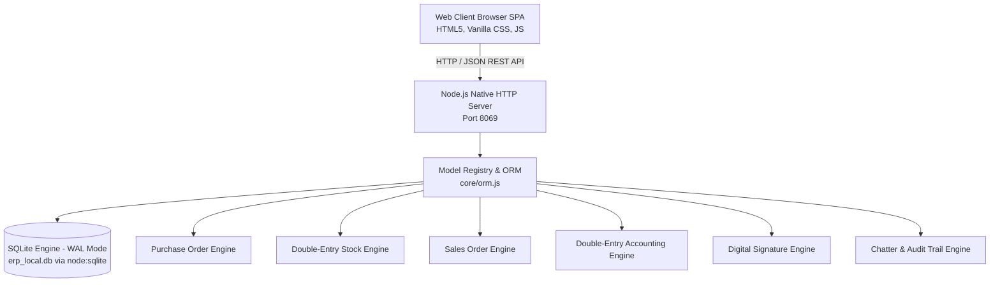

# 📖 Dokumentasi Lengkap ERP Core Local Engine

> **Versi:** 1.0 Enterprise Local Engine  
> **Port Standar:** `8069`  
> **Arsitektur:** 100% Native Node.js (Node.js v22+) & SQLite (WAL Mode)  
> **Ketergantungan Eksternal:** `0` (Zero Cloud Fees / Tanpa dependensi pihak ketiga)

---

## 📑 Daftar Isi
1. [Arsitektur & Gambaran Umum Sistem](#1-arsitektur--gambaran-umum-sistem)
2. [Cara Menjalankan Program di Lokal](#2-cara-menjalankan-program-di-lokal)
3. [Cara Testing Unit Fitur](#3-cara-testing-unit-fitur)
4. [Katalog & Panduan Seluruh Fitur](#4-katalog--panduan-seluruh-fitur)
   - [Dashboard Eksekutif](#41-dashboard-eksekutif)
   - [Modul Pembelian (Purchase / RFQ)](#42-modul-pembelian-purchase--rfq)
   - [Modul Persediaan & Gudang (Inventory & Warehouse)](#43-modul-persediaan--gudang-inventory--warehouse)
   - [Modul Penjualan & Analisis Margin (Sales / SO)](#44-modul-penjualan--analisis-margin-sales--so)
   - [Sub-menu Pesanan Siap Ditagih (Orders to Invoice)](#45-sub-menu-pesanan-siap-ditagih-orders-to-invoice)
   - [Modul Invoicing & Akuntansi Double-Entry](#46-modul-invoicing--akuntansi-double-entry)
   - [Stock Opname Mingguan & Jurnal Penyesuaian](#47-stock-opname-mingguan--jurnal-penyesuaian)
   - [Valuasi Stok Bulanan & Roll-Over Otomatis](#48-valuasi-stok-bulanan--roll-over-otomatis)
   - [Rekonsiliasi Akuntansi (Bank, Piutang, Hutang)](#49-rekonsiliasi-akuntansi-bank-piutang-hutang)
   - [Digital Signature & Audit Hash](#410-digital-signature--audit-hash)
   - [Chatter & Jejak Audit (Audit Trail)](#411-chatter--jejak-audit-audit-trail)
5. [Dokumentasi Lengkap API (API Reference)](#5-dokumentasi-lengkap-api-api-reference)
   - [1. Partner & Kontak API](#51-partner--kontak-api)
   - [2. Produk & Katalog API](#52-produk--katalog-api)
   - [3. Persediaan & Stock Picking API](#53-persediaan--stock-picking-api)
   - [4. Pembelian (Purchase Orders) API](#54-pembelian-purchase-orders-api)
   - [5. Penjualan (Sales Orders) API](#55-penjualan-sales-orders-api)
   - [6. Akuntansi: Faktur, Tagihan & Jurnal API](#56-akuntansi-faktur-tagihan--jurnal-api)
   - [7. Akuntansi: Laporan Keuangan API](#57-akuntansi-laporan-keuangan-api)
   - [8. Stock Opname Mingguan API](#58-stock-opname-mingguan-api)
   - [9. Valuasi & Tutup Buku Stok API](#59-valuasi--tutup-buku-stok-api)
   - [10. Rekonsiliasi Akuntansi API](#510-rekonsiliasi-akuntansi-api)
   - [11. Tanda Tangan Digital (Digital Signature) API](#511-tanda-tangan-digital-digital-signature-api)
   - [12. Chatter & Dashboard KPI API](#512-chatter--dashboard-kpi-api)

---

## 1. Arsitektur & Gambaran Umum Sistem

Sistem ini adalah mesin ERP mandiri (*standalone enterprise engine*) terpadu yang berjalan secara lokal dengan karakteristik utama:

- **100% Native Node.js**: Menggunakan modul bawaan Node.js (`node:http`, `node:sqlite`, `node:fs`, `node:path`, `node:assert`, `node:crypto`). Tidak memerlukan instalasi paket `npm` tambahan (`zero node_modules`).
- **Database Engine**: Menggunakan **SQLite DatabaseSync** bawaan Node.js v22+ dengan **Write-Ahead Logging (WAL)** aktif dan penegakan **Foreign Keys** untuk integritas data ACID.
- **Pola Desain Arsitektur Enterprise**:
  - **Model Registry & ORM**: Pola `registry.env('model.name')` untuk orkestrasi model, CRUD, relasi dokumen, dan pemanggilan alur kerja (*workflows*).
  - **Double-Entry Stock Movement**: Perpindahan stok gudang mengikuti prinsip akuntansi persediaan berimbang (*double-entry stock tracking*) dari lokasi sumber ke lokasi tujuan (*Vendors* $\rightarrow$ *WH/Stock* $\rightarrow$ *Customers*).
  - **Double-Entry General Ledger**: Setiap posting jurnal memastikan Debit $\equiv$ Kredit sebelum tersimpan ke Buku Besar (*account_move* & *account_move_line*).
  - **Document Sequence Generator**: Penomoran dokumen otomatis berurutan (`PO0001`, `SO0001`, `WH/IN/0001`, `WH/OUT/0001`, `INV/2026/0001`, `BILL/2026/0001`, `STK/2026/0001`, dsb).
  - **Chatter & Audit Trail**: Setiap transaksi dan perubahan status (*state transition*) otomatis tercatat pada tabel `mail_message`.
  - **Digital Signature**: Mesin tanda tangan digital lokal (Canvas Draw & Type Cursive) dengan enkripsi verifikasi hash SHA-256 dan terhubung langsung ke format cetak faktur.



---

## 2. Cara Menjalankan Program di Lokal

### Prasyarat Sistem
- **Node.js**: Versi **v22.0.0** atau lebih baru (karena modul bawaan `node:sqlite` membutuhkan Node.js v22+).
- **Sistem Operasi**: Windows, macOS, atau Linux.

### Langkah-langkah Menjalankan:

1. **Periksa Versi Node.js**:
   Buka terminal/PowerShell dan pastikan versi Node.js sudah mendukung:
   ```bash
   node -v
   # Contoh output: v22.11.0 atau v26.11.1
   ```

2. **Masuk ke Direktori Proyek**:
   ```bash
   cd "ERP-project-automation"
   ```

3. **Jalankan Server**:
   Jalankan server aplikasi tanpa perlu menginstal paket apapun (`npm install` tidak diperlukan):
   ```bash
   node server.js
   ```

   **Output Terminal yang Diharapkan:**
   ```text
   ================================================================
   🚀 ERP Local Core Engine is running!
   🌐 Local Web Client: http://localhost:8069
   📦 Port: 8069 (Default Port)
   ================================================================
   ```

4. **Akses Antarmuka Web (Web Client)**:
   Buka browser (Google Chrome, Firefox, Edge, Safari) dan navigasikan ke alamat:
   ```
   http://localhost:8069
   ```

> 💡 **Catatan Inisialisasi Database**:  
> Saat pertama kali dijalankan, sistem secara otomatis membuat berkas basis data `erp_local.db` dan mengisinya dengan *seed data* awal (Perusahaan, Bagan Akun COA, Jurnal, Master Pajak PPN 11%, Master Produk Bahan Baku, Gudang, Tipe Pengiriman, dan Kontak Rekanan).

---

## 3. Cara Testing Unit Fitur

Proyek ini telah dilengkapi dengan rangkaian pengujian otomatis (*automated unit & integration test runner*) yang komprehensif pada berkas `test_local.js`.

### Menjalankan Pengujian
Jalankan perintah berikut di terminal:
```bash
node test_local.js
```

### Hasil Eksekusi & Cakupan Pengujian
Pengujian mencakup **30 skenario bisnis end-to-end** dengan tingkat kelulusan 100%:

| No | Nama Skenario Uji | Deskripsi Pengujian |
|---|---|---|
| **1** | Master Data Integrity | Verifikasi keberadaan dan keutuhan partner, UOM, lokasi gudang, dan produk. |
| **2** | Create Purchase Order | Pembuatan PO baru berstatus `draft` dengan nomor urut resmi `POxxxx`. |
| **3** | Confirm Purchase Order | Konfirmasi PO otomatis membentuk *Inbound Picking* (`WH/IN/xxxx`) berstatus `assigned`. |
| **4** | Double-Entry Inbound Validation | Validasi penerimaan barang memindahkan stok dari *Vendors* ke *WH/Stock* dan mengupdate `qty_received`. |
| **5** | Create Sales Order | Pembuatan SO baru berstatus `draft` dengan nomor urut resmi `SOxxxx`. |
| **6** | Confirm Sales Order | Konfirmasi SO otomatis membentuk *Delivery Order Outbound* (`WH/OUT/xxxx`). |
| **7** | Delivery Validation & Stock Deduction | Validasi pengiriman mengurangi saldo kuantitas *stock quant* di *WH/Stock* dan mengupdate `qty_delivered`. |
| **8** | Chatter & Audit Trail Integrity | Memastikan setiap dokumen merekam jejak perubahan status dan histori pesan. |
| **9** | Vendor Bill Creation | Pembuatan Tagihan Pemasok (`in_invoice`) berstatus `draft` langsung dari PO. |
| **10** | Vendor Bill Posting (Double-Entry) | Posting tagihan memastikan keseimbangan Debit (HPP) $\equiv$ Kredit (Hutang). |
| **11** | Vendor Bill Payment Registration | Registrasi pembayaran tagihan via Jurnal Bank Mandiri hingga berstatus `paid`. |
| **12** | Customer Invoice Creation | Pembuatan Faktur Penjualan (`out_invoice`) berstatus `draft` langsung dari SO. |
| **13** | Customer Invoice Posting | Posting faktur memastikan keseimbangan Debit (Piutang) $\equiv$ Kredit (Penjualan). |
| **14** | Customer Payment Registration | Penerimaan pembayaran dari pelanggan via Bank Mandiri hingga faktur lunas (`amount_residual = 0`). |
| **15** | General Ledger & P&L Report | Menguji keakuratan perhitungan Buku Besar dan laporan Laba Rugi real-time. |
| **16** | Manual Balanced Journal Entry | Validasi pembuatan entri jurnal multi-baris bebas dengan pengecekan keseimbangan debit-kredit. |
| **17** | Reversal / Credit Note (Nota Retur) | Pembuatan nota retur (`out_refund`) yang membalikkan debit/kredit dokumen sumber. |
| **18** | Trial Balance Verification | Neraca saldo menguji Total Debit $\equiv$ Total Kredit secara menyeluruh. |
| **19** | Balance Sheet Verification | Neraca keuangan menguji persamaan akuntansi: Total Aktiva $\equiv$ Total Pasiva + Ekuitas. |
| **20** | Export General Ledger to CSV | Menguji ekspor Buku Besar ke format berkas CSV standar akuntansi. |
| **21** | Direct Invoice with PPN 11% | Pembuatan faktur penjualan langsung dengan kalkulasi PPN Keluaran 11% otomatis. |
| **22** | Direct Vendor Bill with PPN 11% | Pembuatan tagihan pemasok langsung dengan kalkulasi PPN Masukan 11% otomatis. |
| **23** | Tax Summary Report (SPT Masa PPN) | Rekapitulasi perbandingan PPN Keluaran vs PPN Masukan dan status Lebih/Kurang Bayar. |
| **24** | COA Customization | Menambah kode akun baru ke Bagan Akun (*Chart of Accounts*) secara dinamis. |
| **25** | Weekly Stock Opname | Hitung fisik mingguan, deteksi selisih stok, auto-koreksi kuantitas dan pembentukan jurnal selisih (*STK*). |
| **26** | Monthly Stock Valuation & Roll-over | Tutup buku bulanan persediaan: Otomatis membentuk Jurnal Persediaan Akhir ($M$) dan Persediaan Awal ($M+1$). |
| **27** | Accounting Reconciliation | Menguji *overview* akun rekonsiliasi dan eksekusi algoritma *auto-match* transaksi berpasangan. |
| **28** | Orders To Invoice Workflow | Alur lengkap pesanan terkirim: Deteksi siap ditagih, buat draft faktur, ubah draft, posting, bayar, dan cetak. |
| **29** | Sales Margin Analysis | Verifikasi kalkulasi margin laba kotor per item barang (HPP vs Harga Jual) dan margin total pesanan. |
| **30** | Digital Signature Engine | Pembuatan tanda tangan digital, hash kriptografi SHA-256, verifikasi chatter, dan integrasi cetak faktur. |

### Menambahkan Unit Test Baru
Anda dapat menambahkan skenario pengujian baru pada berkas `test_local.js` dengan fungsi pembantu `test(nama, fn)`:
```javascript
test('31. Nama Pengujian Baru', () => {
    const data = registry.env('res.partner').search_read({ is_customer: true });
    assert.ok(data.length > 0, 'Daftar customer tidak boleh kosong');
});
```

---

## 4. Katalog & Panduan Seluruh Fitur

### 4.1 Dashboard Eksekutif
- **Metrik Utama (KPIs)**: Total Produk Aktif, Jumlah Pemasok & Pelanggan, Penerimaan Tertunda (*Pending Receipts*), Pengiriman Tertunda (*Pending Deliveries*), Total Nilai Aset Persediaan Gudang, Total Piutang Usaha, Total Hutang Usaha, serta Laba Bersih Tahun Berjalan.
- **Tautan Cepat**: Akses instan ke modul-modul utama untuk efisiensi operasional.

### 4.2 Modul Pembelian (Purchase / RFQ)
- Pembuatan penawaran pengadaan bahan baku (*Request for Quotation*).
- Penambahan multi-item produk lengkap dengan kuantitas, satuan (UOM), dan harga satuan.
- Tombol **Konfirmasi Pesanan**: Mengubah status dari `draft` ke `purchase`, serta memicu pembuatan dokumen penerimaan barang (*Inbound Receipt / WH/IN*).
- Tombol **Buat Tagihan (Create Bill)**: Membuat tagihan pemasok (*Vendor Bill*) di bagian akuntansi secara otomatis berdasarkan pesanan yang disetujui.

### 4.3 Modul Persediaan & Gudang (Inventory & Warehouse)
- **Double-Entry Stock Architecture**:
  - Lokasi Internal: `WH/Stock`
  - Lokasi Pemasok: `Partner Locations/Vendors`
  - Lokasi Pelanggan: `Partner Locations/Customers`
  - Lokasi Virtual Penyesuaian: `Virtual Locations/Inventory adjustment`
- **Operasi Penerimaan (Receipts - WH/IN)**: Memeriksa dan memvalidasi barang masuk dari pemasok ke gudang utama.
- **Operasi Pengiriman (Delivery Orders - WH/OUT)**: Memvalidasi pengeluaran barang dari gudang ke pelanggan.
- **Stock Quants (On-Hand Balance)**: Pelacakan kuantitas stok fisik secara *real-time* per lokasi dan per produk.

### 4.4 Modul Penjualan & Analisis Margin (Sales / SO)
- Pembuatan penawaran harga (*Quotation*) dan pesanan penjualan (*Sales Order*).
- **Analisis Margin Laba Kotor Real-Time**:
  - Menampilkan Harga Pokok Penjualan (HPP / *standard_price*) modal barang.
  - Menghitung margin laba kotor per baris dalam Rupiah dan persentase ($\% \text{ Margin} = \frac{\text{Subtotal} - \text{HPP Total}}{\text{Subtotal}} \times 100\%$).
  - Menghitung total omset penjualan, total beban pokok, dan margin laba kotor keseluruhan order.
- Tombol **Konfirmasi Pesanan**: Membentuk dokumen pengiriman keluar (*WH/OUT*).
- Tombol **Buat Faktur (Create Invoice)**: Menghasilkan faktur penjualan pelanggan langsung di akuntansi.

### 4.5 Sub-menu Pesanan Siap Ditagih (Orders to Invoice)
- Dirancang khusus untuk bagian *Finance & Invoicing*.
- Menampilkan daftar seluruh pesanan penjualan yang telah berstatus *Dalam Pengiriman* (`assigned`) maupun *Terkirim Penuh* (`done`).
- Indikator status faktur interaktif: *Belum Ditagih*, *Draft Faktur*, *Posted*, atau *Lunas (Paid)*.
- **Alur Edit Draft Faktur**:
  - Staf dapat membuat draf faktur, menyunting nomor referensi, tanggal jatuh tempo, dan nominal sebelum dikonfirmasi.
  - Setelah posting, dapat langsung didaftarkan pelunasan pembayarannya.
  - Tombol **Cetak Faktur**: Menghasilkan dokumen cetak resmi berstandar profesional enterprise yang memuat rincian item, pajak, dan tanda tangan digital.

### 4.6 Modul Invoicing & Akuntansi Double-Entry
- **Jenis Dokumen Akuntansi**:
  - Faktur Penjualan Pelanggan (`out_invoice`)
  - Tagihan Pembelian Pemasok (`in_invoice`)
  - Nota Kredit / Retur Penjualan (`out_refund`)
  - Nota Retur Pembelian (`in_refund`)
  - Entri Jurnal Umum / Manual (`entry`)
- **Faktur & Tagihan Langsung (Direct Invoicing)**:
  - Fasilitas membuat faktur atau tagihan langsung tanpa melalui SO/PO terlebih dahulu.
  - Perhitungan **PPN 11% otomatis** (PPN Masukan akun `11210030` dan PPN Keluaran akun `21210010`).
- **Entri Jurnal Manual (Multi-Line)**:
  - Fasilitas pencatatan biaya operasional, gaji, penyusutan aset, dan akrual.
  - Validasi ketat: Tombol simpan terkunci jika total debit $\neq$ total kredit.
- **Nota Kredit / Pembalik (Reversal)**:
  - Membalikkan dokumen akuntansi yang salah/retur secara otomatis dengan referensi silang.
- **Registrasi Pembayaran**:
  - Mendukung pembayaran melalui Kas maupun Bank (e.g. Bank Mandiri, Kas Kecil).
  - Mengupdate sisa tagihan (*amount_residual*) dan status pembayaran (*paid*).
- **Laporan Keuangan Terpadu**:
  - **Buku Besar (General Ledger)**: Rincian mutasi debit/kredit per akun + fasilitas **Ekspor CSV**.
  - **Neraca Saldo (Trial Balance)**: Memastikan keseimbangan seluruh akun sebelum tutup buku.
  - **Neraca Keuangan (Balance Sheet)**: Struktur standar Total Aktiva $\equiv$ Total Pasiva + Ekuitas.
  - **Laba Rugi (Profit and Loss)**: Pendapatan vs Beban Operasional & HPP.
  - **Buku Pembantu Rekanan (Partner Ledger)**: Saldo mutasi piutang/hutang per pelanggan/pemasok.
  - **Rekapitulasi Pajak (SPT Masa PPN)**: Komparasi PPN Keluaran vs PPN Masukan.

### 4.7 Stock Opname Mingguan & Jurnal Penyesuaian
- Didesain untuk manajemen inventaris ritel/pabrik (W01, W02, W03, W04, W05).
- Memuat kuantitas sistem (*theoretical_qty*) dan kolom input hasil hitung fisik (*counted_qty*).
- Menghitung selisih kuantitas (*difference_qty*) dan valuasi selisih (*variance_value*).
- Saat divalidasi:
  1. Mengoreksi saldo fisik di `stock_quant`.
  2. Otomatis membuat Entri Jurnal Selisih Stok (`STK/2026/xxxx`) yang menghubungkan akun *Persediaan Bahan Baku* (`11300010`) dan akun *Selisih / Kerusakan Stok Opname* (`51000030`).

### 4.8 Valuasi Stok Bulanan & Roll-Over Otomatis
- Menyediakan rekapitulasi nilai persediaan akhir bulan berdasarkan kuantitas fisik dan harga standar (*standard_price*).
- Fitur **Tutup Buku Bulanan (Monthly Closing)**:
  - **Jurnal 1 (Akhir Bulan $M$)**: Mengakui Persediaan Akhir (Debit *Persediaan Bahan Baku* `11300010` & Kredit *Persediaan Akhir* `51000020`).
  - **Jurnal 2 (Awal Bulan $M+1$)**: Melakukan *roll-over* otomatis ke tanggal 1 bulan berikutnya (Debit *Persediaan Awal* `51000015` & Kredit *Persediaan Bahan Baku* `11300010`).

### 4.9 Rekonsiliasi Akuntansi (Bank, Piutang, Hutang)
- Panel ringkasan untuk akun-akun rekonsiliasi (Piutang Usaha, Hutang Usaha, Bank Mandiri, Kas).
- Fitur **Pencocokan Otomatis (Auto-Match)**: Memindai pasangan item jurnal (*account_move_line*) yang belum direkonsiliasi dengan nominal debit dan kredit yang sama serta rekanan yang cocok.
- Fitur **Pencocokan Manual**: Memilih baris transaksi tertentu dan menyelesaikannya dengan memo rekonsiliasi.

### 4.10 Digital Signature & Audit Hash
- Fitur tanda tangan digital terintegrasi untuk Sales Order dan Faktur Penjualan.
- **Dua Mode Tanda Tangan**:
  1. *Draw Mode*: Menggambar tanda tangan langsung pada kanvas sentuh/mouse.
  2. *Type Mode*: Mengetik nama dengan konversi otomatis ke jenis huruf kaligrafi resmi.
- **Audit Security Hash**: Setiap tanda tangan menghasilkan kode unik kriptografis berbasis SHA-256 (format: `SIG-YYYY-XXXX-YYYY`).
- Mencatat nama penandatangan, peran/jabatan, alamat IP penandatangan, dan waktu penandatanganan.
- Otomatis membuat log riwayat pada Chatter dokumen.
- Tersemat langsung pada lembar cetak dokumen faktur (*Customer Signature* & *Authorized Company Signer*).
- Tersedia fitur pencabutan (*revocation*) dengan pencatatan pembatalan pada audit trail.

### 4.11 Chatter & Jejak Audit (Audit Trail)
- Tersemat di sisi kanan setiap lembar formulir (*Form View*).
- Merekam setiap aksi penting (pembuatan, perubahan status, validasi gudang, pembayaran, tanda tangan digital).
- Memungkinkan staf operasional menambahkan catatan internal atau pesan diskusi.

---

## 5. Dokumentasi Lengkap API (API Reference)

Semua *endpoint* menggunakan format data JSON (`application/json`) dan mendukung CORS standar.

---

### 5.1 Partner & Kontak API

#### `GET /api/partners`
Mengambil daftar rekanan (pelanggan dan pemasok).
- **Query Parameters**:
  - `is_customer`: `1` (hanya pelanggan) atau `0`
  - `is_supplier`: `1` (hanya pemasok) atau `0`
- **Contoh Request**:
  ```http
  GET /api/partners?is_customer=1 HTTP/1.1
  Host: localhost:8069
  ```
- **Contoh Response (200 OK)**:
  ```json
  {
    "success": true,
    "data": [
      {
        "id": 4,
        "name": "Bakery Roti Manis Lestari",
        "is_company": 1,
        "is_customer": 1,
        "is_supplier": 0,
        "phone": "0812-1111-2222",
        "email": "roti.lestari@example.com",
        "street": "Jl. Pajajaran No. 45",
        "city": "Bogor",
        "active": 1
      }
    ]
  }
  ```

#### `POST /api/partners`
Menambahkan rekanan baru.
- **Request Body**:
  ```json
  {
    "name": "PT Mitra Jaya Abadi",
    "is_company": true,
    "is_customer": true,
    "is_supplier": false,
    "phone": "021-5556677",
    "email": "info@mitrajaya.example",
    "street": "Jl. Sudirman Kav 20",
    "city": "Jakarta Pusat"
  }
  ```
- **Contoh Response (201 Created)**:
  ```json
  {
    "success": true,
    "id": 7
  }
  ```

---

### 5.2 Produk & Katalog API

#### `GET /api/products`
Mengambil seluruh katalog produk beserta satuan dan saldo persediaan terkini (*qty_available*).
- **Contoh Response (200 OK)**:
  ```json
  {
    "success": true,
    "data": [
      {
        "id": 1,
        "name": "Tepung Terigu Cakra Kembar",
        "default_code": "RM-TRG-01",
        "type": "product",
        "uom_id": 1,
        "uom_name": "Kg",
        "list_price": 14500,
        "standard_price": 11500,
        "qty_available": 150
      }
    ]
  }
  ```

---

### 5.3 Persediaan & Stock Picking API

#### `GET /api/stock/quants`
Mengambil rincian stok fisik (*on hand*) di setiap lokasi gudang.
- **Contoh Response (200 OK)**:
  ```json
  {
    "success": true,
    "data": [
      {
        "id": 1,
        "product_id": 1,
        "product_name": "Tepung Terigu Cakra Kembar",
        "default_code": "RM-TRG-01",
        "uom_name": "Kg",
        "location_id": 2,
        "location_name": "WH/Stock",
        "quantity": 150,
        "reserved_quantity": 0
      }
    ]
  }
  ```

#### `GET /api/pickings`
Mengambil daftar dokumen transfer persediaan (*Inbound*, *Outbound*, *Internal*).
- **Contoh Response (200 OK)**:
  ```json
  {
    "success": true,
    "data": [
      {
        "id": 1,
        "name": "WH/IN/0001",
        "picking_type_name": "Penerimaan (Receipts)",
        "partner_name": "PT Bogasari Flour Mills",
        "origin": "PO0001",
        "state": "assigned",
        "created_at": "2026-03-20 10:00:00"
      }
    ]
  }
  ```

#### `GET /api/pickings/:id`
Mengambil detail picking beserta daftar baris pergerakan barang (*stock moves*) dan riwayat *chatter*.

#### `POST /api/pickings/:id/validate`
Memvalidasi transfer barang. Eksekusi perpindahan kuantitas stok di *stock quant*, memperbarui kuantitas pesanan terkait (*qty_received* atau *qty_delivered*), dan mengubah status menjadi `done`.
- **Contoh Response (200 OK)**:
  ```json
  {
    "success": true,
    "message": "Picking WH/IN/0001 berhasil divalidasi ke status DONE. Mutasi stok berhasil diposting."
  }
  ```

---

### 5.4 Pembelian (Purchase Orders) API

#### `GET /api/purchases`
Mengambil daftar seluruh pesanan pembelian (PO / RFQ).

#### `POST /api/purchases`
Membuat pesanan pembelian baru (*Draft RFQ*).
- **Request Body**:
  ```json
  {
    "partner_id": 1,
    "notes": "Pengadaan Bahan Baku Roti Minggu 1",
    "lines": [
      { "product_id": 1, "product_qty": 100, "price_unit": 11500 },
      { "product_id": 2, "product_qty": 50, "price_unit": 15000 }
    ]
  }
  ```
- **Contoh Response (201 Created)**:
  ```json
  {
    "success": true,
    "data": {
      "id": 1,
      "name": "PO0001"
    }
  }
  ```

#### `GET /api/purchases/:id`
Mengambil rincian PO, baris pesanan, status barang yang sudah diterima (*qty_received*), dan riwayat aktivitas.

#### `POST /api/purchases/:id/confirm`
Mengonfirmasi PO menjadi *Purchase Order* resmi dan otomatis membentuk *Inbound Picking*.
- **Contoh Response (200 OK)**:
  ```json
  {
    "success": true,
    "message": "Purchase order PO0001 confirmed. Inbound picking created.",
    "picking_id": 1,
    "picking_name": "WH/IN/0001"
  }
  ```

#### `POST /api/purchases/:id/create-bill`
Membuat draf Tagihan Pemasok (*Vendor Bill*) di akuntansi berdasarkan PO yang telah disetujui.
- **Contoh Response (200 OK)**:
  ```json
  {
    "success": true,
    "bill_id": 1,
    "bill_name": "BILL/2026/0001",
    "message": "Vendor Bill BILL/2026/0001 berhasil dibuat dari PO0001."
  }
  ```

---

### 5.5 Penjualan (Sales Orders) API

#### `GET /api/sales`
Mengambil daftar pesanan penjualan (SO / Quotation).

#### `POST /api/sales`
Membuat penawaran penjualan baru (*Draft Quotation*).
- **Request Body**:
  ```json
  {
    "partner_id": 4,
    "notes": "Pesanan Pengiriman Kafe Sentul",
    "lines": [
      { "product_id": 1, "product_uom_qty": 30, "price_unit": 14500 }
    ]
  }
  ```
- **Contoh Response (201 Created)**:
  ```json
  {
    "success": true,
    "data": {
      "id": 1,
      "name": "SO0001"
    }
  }
  ```

#### `GET /api/sales/:id`
Mengambil detail SO lengkap dengan rincian baris pesanan dan **analisis margin laba kotor** (modal HPP *standard_price*, laba kotor baris, dan persentase margin).

#### `POST /api/sales/:id/confirm`
Mengonfirmasi SO menjadi pesanan resmi dan otomatis memicu *Delivery Order Outbound*.
- **Contoh Response (200 OK)**:
  ```json
  {
    "success": true,
    "message": "Sales order SO0001 confirmed. Delivery order created.",
    "picking_id": 2,
    "picking_name": "WH/OUT/0001"
  }
  ```

#### `POST /api/sales/:id/create-invoice`
Membuat draf Faktur Penjualan Pelanggan (*Customer Invoice*) di akuntansi berdasarkan SO.
- **Contoh Response (200 OK)**:
  ```json
  {
    "success": true,
    "invoice_id": 1,
    "invoice_name": "INV/2026/0001",
    "message": "Customer Invoice INV/2026/0001 berhasil dibuat dari SO0001."
  }
  ```

---

### 5.6 Akuntansi: Faktur, Tagihan & Jurnal API

#### `GET /api/account/moves`
Mengambil daftar dokumen akuntansi (*invoices, bills, journal entries*).
- **Query Parameters**:
  - `move_type`: `out_invoice` (faktur penjualan), `in_invoice` (tagihan vendor), `out_refund` (nota kredit), `entry` (jurnal manual)
  - `state`: `draft`, `posted`, `cancel`
  - `payment_state`: `not_paid`, `in_payment`, `paid`

#### `GET /api/account/moves/:id`
Mengambil rincian dokumen akuntansi, daftar debit/kredit baris jurnal (*line_ids*), riwayat pembayaran (*payments*), tanda tangan digital (*signatures*), dan *chatter*.

#### `PUT /api/account/moves/:id`
Menyunting draf faktur (*Draft Invoice*) sebelum diposting (nomor referensi, tanggal, rekanan, dan total nominal).
- **Request Body**:
  ```json
  {
    "partner_id": 4,
    "date": "2026-03-25",
    "ref": "INV-REF-CUSTOM-001",
    "amount_total": 550000
  }
  ```

#### `POST /api/account/moves/:id/post`
Memvalidasi dan memposting dokumen akuntansi ke Buku Besar umum (*General Ledger*).

#### `POST /api/account/moves/:id/register-payment`
Mendaftarkan pembayaran/pelunasan atas faktur atau tagihan.
- **Request Body**:
  ```json
  {
    "journal_id": 3,
    "amount": 550000,
    "date": "2026-03-25",
    "memo": "Pelunasan Transfer Mandiri"
  }
  ```
- **Contoh Response (200 OK)**:
  ```json
  {
    "success": true,
    "new_state": "paid",
    "amount_residual": 0,
    "message": "Pembayaran sebesar Rp 550.000 berhasil dicatat. Status faktur: PAID (Lunas)."
  }
  ```

#### `POST /api/account/moves/:id/reverse`
Membuat Nota Kredit / Pembalik (*Credit Note*) atas dokumen yang telah diposting.
- **Request Body**:
  ```json
  {
    "reason": "Retur kerusakan sebagian barang"
  }
  ```

#### `GET /api/account/moves/:id/print`
Mengambil payload data lengkap untuk format cetak lembar faktur resmi (identitas perusahaan, pelanggan, rincian barang/jasa, pajak, serta tanda tangan digital otentik).

#### `GET /api/account/orders-to-invoice`
Mengambil daftar pesanan penjualan yang telah dalam proses pengiriman (`assigned`) atau terkirim (`done`) beserta status fakturnya untuk kemudahan penagihan (*Orders to Invoice*).

#### `POST /api/account/invoices`
Membuat faktur penjualan atau tagihan vendor secara langsung (tanpa melalui SO/PO) dengan perhitungan PPN 11% otomatis.
- **Request Body**:
  ```json
  {
    "move_type": "out_invoice",
    "partner_id": 4,
    "ref": "Penjualan Langsung Ritel",
    "lines": [
      { "product_id": 1, "quantity": 10, "price_unit": 100000, "apply_ppn": true }
    ]
  }
  ```

#### `POST /api/account/entries`
Membuat Entri Jurnal Manual multi-baris (contoh: beban listrik, gaji, penyesuaian biaya).
- **Request Body**:
  ```json
  {
    "journal_id": 5,
    "ref": "Akrual Beban Listrik Maret 2026",
    "lines": [
      { "account_id": 14, "name": "Beban Listrik", "debit": 750000, "credit": 0 },
      { "account_id": 12, "name": "Hutang Biaya (BYMHD)", "debit": 0, "credit": 750000 }
    ]
  }
  ```

#### `GET /api/account/coa`
Mengambil seluruh Bagan Akun (*Chart of Accounts*).

#### `POST /api/account/coa`
Menambahkan akun baru ke Bagan Akun (*Chart of Accounts*).
- **Request Body**:
  ```json
  {
    "code": "11130001",
    "name": "Rekening Bank BCA Operasional",
    "type": "asset_cash",
    "reconcile": true
  }
  ```

---

### 5.7 Akuntansi: Laporan Keuangan API

| Endpoint | Method | Deskripsi |
|---|---|---|
| `/api/account/reports/general-ledger` | `GET` | Mengambil seluruh Buku Besar akun beserta mutasi baris transaksi debit dan kredit. |
| `/api/account/reports/profit-and-loss` | `GET` | Laporan Laba Rugi: Total Pendapatan, Total Beban Pokok/Operasional, dan Laba Bersih (*Net Profit*). |
| `/api/account/reports/trial-balance` | `GET` | Neraca Saldo: Daftar akun, total debit, total kredit, dan indikator keseimbangan (*isBalanced*). |
| `/api/account/reports/balance-sheet` | `GET` | Neraca Keuangan: Klasifikasi Total Aset vs Total Kewajiban & Ekuitas. |
| `/api/account/reports/partner-ledger` | `GET` | Buku Pembantu Rekanan: Rincian saldo piutang dan hutang per partner. |
| `/api/account/reports/tax` | `GET` | Rekapitulasi Pajak PPN: PPN Keluaran, PPN Masukan, dan status Lebih/Kurang Bayar. |
| `/api/account/export/csv` | `GET` | Mengunduh berkas CSV Buku Besar standar (*Buku_Besar_ERP_Local.csv*). |

---

### 5.8 Stock Opname Mingguan API

#### `GET /api/stock/opname`
Mengambil daftar sesi *Stock Opname*. Dapat difilter menggunakan query `period_month=2026-03` dan `week_number=2`.

#### `POST /api/stock/opname`
Membuat sesi *Stock Opname* mingguan baru.
- **Request Body**:
  ```json
  {
    "period_month": "2026-03",
    "week_number": 2,
    "notes": "Opname Rutin Mingguan Gudang Utama",
    "lines": [
      { "product_id": 1, "counted_qty": 98 }
    ]
  }
  ```

#### `GET /api/stock/opname/:id`
Mengambil rincian sesi opname beserta daftar perhitungan fisik.

#### `POST /api/stock/opname/:id/lines`
Memperbarui kuantitas hasil hitung fisik (*counted_qty*) pada baris-baris opname.

#### `POST /api/stock/opname/:id/validate`
Memvalidasi sesi opname: Mengoreksi *stock quant* fisik dan otomatis membentuk entri jurnal penyesuaian selisih inventaris (*STK/2026/xxxx*).

---

### 5.9 Valuasi & Tutup Buku Stok API

#### `GET /api/stock/valuation/report`
Mengambil laporan valuasi stok terkini (kuantitas fisik, harga standar, total nilai per produk, dan akumulasi total aset stok).

#### `POST /api/stock/valuation/monthly-close`
Melakukan proses Tutup Buku Bulanan atas persediaan:
- **Request Body**:
  ```json
  {
    "period_month": "2026-03",
    "closing_date": "2026-03-31"
  }
  ```
- **Contoh Response (200 OK)**:
  ```json
  {
    "success": true,
    "period_month": "2026-03",
    "next_period_month": "2026-04",
    "total_stock_value": 23030500,
    "closing_move_id": 26,
    "opening_move_id": 27,
    "message": "Tutup buku stok periode 2026-03 berhasil dilakukan. Jurnal Persediaan Akhir dan Jurnal Roll-over Persediaan Awal telah diposting."
  }
  ```

---

### 5.10 Rekonsiliasi Akuntansi API

#### `GET /api/account/reconciliation/overview`
Mengambil ikhtisar akun-akun rekonsiliasi (Piutang Usaha, Hutang Usaha, Bank, Kas) beserta saldo debit dan kredit yang belum direkonsiliasi.

#### `GET /api/account/reconciliation/lines?account_id=3`
Mengambil baris-baris mutasi jurnal pada akun tertentu yang berstatus belum direkonsiliasi.

#### `POST /api/account/reconciliation/match`
Merekonsiliasi sekelompok baris mutasi secara manual.
- **Request Body**:
  ```json
  {
    "line_ids": [15, 28],
    "memo": "Pencocokan Faktur dengan Pembayaran Bank"
  }
  ```

#### `POST /api/account/reconciliation/auto-match`
Menjalankan algoritma pencocokan otomatis (*Auto-Match Engine*) untuk seluruh akun rekonsiliasi aktif.
- **Contoh Response (200 OK)**:
  ```json
  {
    "success": true,
    "matched_pairs": 3,
    "message": "3 pasangan transaksi berhasil direkonsiliasi otomatis."
  }
  ```

---

### 5.11 Tanda Tangan Digital (Digital Signature) API

#### `POST /api/sign`
Menyimpan tanda tangan digital pada dokumen (Sales Order, Invoice, PO, atau Picking).
- **Request Body**:
  ```json
  {
    "res_model": "sale.order",
    "res_id": 1,
    "signer_name": "Budi Santoso",
    "signer_role": "Customer / Pelanggan",
    "signature_data": "data:image/png;base64,iVBORw0KGgoAAAANSUhEU...",
    "signature_type": "draw"
  }
  ```
- **Contoh Response (201 Created)**:
  ```json
  {
    "success": true,
    "data": {
      "id": 1,
      "sign_hash": "SIG-2026-D3A9-80CE",
      "signer_name": "Budi Santoso",
      "signer_role": "Customer / Pelanggan"
    }
  }
  ```

#### `GET /api/sign/:model/:res_id`
Mengambil seluruh tanda tangan digital resmi yang tersemat pada dokumen tertentu.
- **Contoh**: `GET /api/sign/sale.order/1`

#### `DELETE /api/sign/:id`
Membatalkan / mencabut tanda tangan digital tertentu serta mencatat aktivitas pencabutan pada Chatter dokumen.

---

### 5.12 Chatter & Dashboard KPI API

#### `POST /api/chatter/message`
Mengirimkan catatan internal atau pesan diskusi ke riwayat dokumen (*Chatter*).
- **Request Body**:
  ```json
  {
    "model": "purchase.order",
    "res_id": 1,
    "body": "Konfirmasi supplier: barang akan dikirim besok pagi.",
    "author": "Manager Pengadaan"
  }
  ```

#### `GET /api/stats`
Mengambil metrik ringkasan kinerja operasional & keuangan untuk antarmuka *Dashboard*.
- **Contoh Response (200 OK)**:
  ```json
  {
    "success": true,
    "stats": {
      "totalProducts": 6,
      "totalVendors": 3,
      "totalCustomers": 3,
      "pendingReceipts": 0,
      "pendingDeliveries": 0,
      "totalStockValue": 23030500,
      "totalReceivable": 0,
      "totalPayable": 0,
      "netProfit": 25898000
    }
  }
  ```

---

### 13. Human Resources (HR) & Payroll API

#### `GET /api/hr/stats`
Mengambil metrik agregat HR untuk dashboard eksekutif: total karyawan aktif, hadir hari ini, izin/cuti, lamaran aktif, dan total anggaran penggajian.

#### `GET /api/hr/employees` & `POST /api/hr/employees` & `PUT /api/hr/employees/:id`
Manajemen direktori karyawan (nama, NIK, jabatan, departemen, email kerja, kontak, nomor rekening bank, NPWP, BPJS Ketenagakerjaan, BPJS Kesehatan, gaji pokok).

#### `GET /api/hr/attendance` & `POST /api/hr/attendance/toggle`
Sistem presensi / kiosk mesin absensi mandiri. Endpoint toggle mencatat `check_in` atau `check_out` real-time serta menghitung durasi jam kerja karyawan.

#### `GET /api/hr/leaves` & `POST /api/hr/leaves` & `POST /api/hr/leaves/:id/approve` & `POST /api/hr/leaves/:id/refuse`
Manajemen permohonan cuti dan izin kerja (tahapan: `draft` $\rightarrow$ `confirm` $\rightarrow$ `validate` / `refuse`).

#### `GET /api/hr/contracts` & `POST /api/hr/contracts`
Manajemen kontrak kerja karyawan, mencakup gaji pokok, tunjangan tetap (makan & transport), dan tanggal mulai/berakhir.

#### `GET /api/hr/payslips` & `POST /api/hr/payslips` & `POST /api/hr/payslips/:id/compute` & `POST /api/hr/payslips/:id/pay` & `GET /api/hr/payslips/:id/print`
Modul penggajian (Payroll) terpadu:
- **Kalkulasi**: Menghitung gaji kotor, BPJS TK 2%, BPJS Kesehatan 1%, estimasi PPh 21, dan gaji bersih (*Take Home Pay*).
- **Posting GL Akuntansi Double-Entry**: Saat status dibayar (`pay`), sistem otomatis membuat dan memposting jurnal berimbang Debit Beban Gaji (`61100010`) dan Kredit Kas/Bank Mandiri (`11120005`) serta Hutang BPJS/Pajak (`21300020`).
- **Pratinjau Cetak**: Menghasilkan dokumen slip gaji resmi berformat standar dengan kalimat terbilang dan *256-bit Digital Audit Hash*.

#### `GET /api/hr/applicants` & `POST /api/hr/applicants` & `POST /api/hr/applicants/:id/stage` & `POST /api/hr/applicants/:id/hire`
Pipeline seleksi rekrutmen Kanban 5 tahap (*Initial*, *Wawancara HR*, *Wawancara User*, *Penawaran*, *Diterima*). Tombol 1-klik `hire` secara otomatis mengonversi pelamar menjadi karyawan resmi.

#### `GET /api/hr/expenses` & `POST /api/hr/expenses` & `POST /api/hr/expenses/:id/approve` & `POST /api/hr/expenses/:id/pay`
Klaim pengeluaran operasional dan reimbursement karyawan terverifikasi.

---

## 6. Ringkasan Berkas Proyek

| Berkas / Direktori | Deskripsi |
|---|---|
| `server.js` | Server HTTP native Node.js (Port `8069`), perutean API RESTful lengkap (Inventory, Accounting, Sales, Purchase, dan HR & Payroll), dan penyedia berkas statis SPA. |
| `core/db.js` | Adapter basis data SQLite berbasis `node:sqlite` (DatabaseSync) dengan mode WAL, skema 10 tabel HR baru (`hr_employee`, `hr_attendance`, `hr_leave`, `hr_payslip`, dll), penegakan foreign keys, dan *seeding* otomatis data awal. |
| `core/orm.js` | Mesin *Model Registry & ORM*, implementasi logika bisnis seluruh modul (CRUD, workflow pergerakan stok, jurnal akuntansi, rekonsiliasi, slip gaji, presensi, pelamar, dan chatter). |
| `test_local.js` | *Test runner* pengujian unit & integrasi otomatis inti (30 uji end-to-end tanpa dependensi eksternal). |
| `test_hr_module.js` | *Test runner* pengujian unit modul Human Resources (8 uji komprehensif alur HR & posting payroll akuntansi). |
| `public/index.html` | Antarmuka pengguna (*Web Client SPA*) terpadu dengan desain responsif, navigasi tab triple dashboard, modal profil karyawan tabbed, dan kanvas rekrutmen Kanban. |
| `public/theme.css` | Sistem desain lengkap bergaya Enterprise Modern dengan palet warna profesional, kartu karyawan, papan kanban, dan layout cetak slip gaji resmi. |
| `public/web_client.js` | Kontroller tampilan *Web Client*: AJAX API dispatcher, state management, render kartu karyawan, presensi kiosk, approval cuti, kalkulator payroll, dan cetak slip. |
| `erp_local.db` | Berkas basis data SQLite lokal (termasuk berkas `-wal` dan `-shm` untuk penanganan transaksi konkurensi tinggi). |

---

*Dokumentasi ini disusun sebagai panduan teknis dan operasional komprehensif untuk pengembang, tester, dan pengguna sistem ERP Core Engine.*
